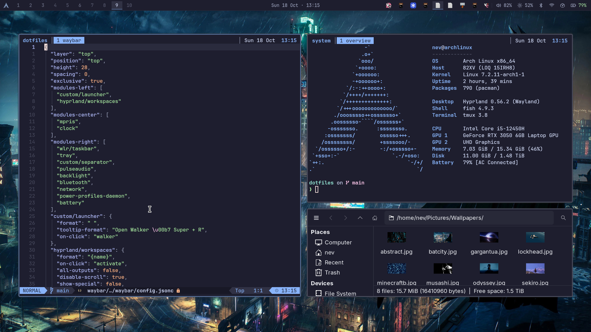

# dotfiles

My Arch + Hyprland setup, using Catppuccin Mocha with muted blue accents.

[](.github/assets/desktop.png)

## What I use

| Component | App |
| --- | --- |
| Desktop | Hyprland + Waybar |
| Terminal | Kitty, Fish, Starship and tmux |
| Launcher | Walker + Elephant |
| Notifications | Mako |
| Lock screen | Hyprlock + Hypridle |
| Files | Thunar |
| Editor | Neovim with LazyVim |
| Wallpapers | awww, with a picker in Walker |

Each app has its own folder. GNU Stow links the configs into place.

## Using it

Install the apps you want first. Back up any existing configs before linking these.

```sh
sudo pacman -S --needed stow
git clone https://github.com/Ethics03/.dotfiles.git ~/dev/dotfiles
cd ~/dev/dotfiles
stow --simulate --verbose --target="$HOME" */
stow --target="$HOME" */
systemctl --user daemon-reload
```

The first Stow command is a preview. You can also link just a few folders, like
`stow --target="$HOME" kitty tmux`, or unlink them with
`stow --delete --target="$HOME" kitty tmux`.

These are my personal configs, so check the monitor names and scales in
`hypr/.config/hypr/monitors.lua` before using them elsewhere. Waybar also has my
battery and backlight names, and a few theme and wallpaper paths use `/home/nev`.

<details>
<summary>Saving changes</summary>

Edit your configs as usual — the links mean you're already editing the repo's files.
To save them to GitHub, review your changes and run:

```sh
cd ~/dev/dotfiles
git diff
git status
git add .
git commit -m "Tweak desktop config"
git push
```

Nothing pushes automatically. On another machine, start with a clean working tree,
then use `git pull --ff-only` and `stow --restow --target="$HOME" */` to update the links.
Reload the apps you changed.

</details>

## Handy keys

| Shortcut | What it does |
| --- | --- |
| Super + Q / E / R | Terminal / files / launcher |
| Super + L / F / W | Lock / fullscreen / wallpapers |
| Super + Shift + L | Sleep |
| Print / Shift + Print | Screenshot / selected area |
| Super + 1–0 | Switch workspace |
| Super + Shift + 1–0 | Move a window to a workspace |
| Super + Ctrl + M | Mirror or extend the displays |
| Super + Ctrl + O / I | Toggle the external / laptop display |
| Ctrl + Space | tmux prefix |

Drop wallpapers in `~/Pictures/Wallpapers`, then press **Super + W** to pick one.
Wallpapers and downloaded themes aren't included in the repo.

<details>
<summary>Packages and theme setup</summary>

These are the packages used on my Arch install:

```text
hyprland hypridle hyprlock hyprpolkitagent waybar kitty fish starship tmux
mako awww grim slurp wl-clipboard libnotify brightnessctl playerctl python
thunar tumbler gvfs qt6ct nwg-look breeze-icons inter-font ttf-jetbrains-mono-nerd
pipewire pipewire-pulse wireplumber bluez blueman pavucontrol
network-manager-applet power-profiles-daemon
xdg-desktop-portal xdg-desktop-portal-hyprland xdg-desktop-portal-gtk
fastfetch neovim fd ripgrep fzf lazygit tree-sitter-cli stow
```

Walker uses `walker-bin`, `elephant` and `elephant-desktopapplications` from the AUR.
Hyprland starts Walker, Elephant, Waybar and the authentication agent at login.
Vicinae also starts in the background using its installed `vicinae.service`.
Super + R currently opens Walker.
NetworkManager, Bluetooth and power-profiles-daemon need their system services too.
The default app settings also reference Helium, Vesktop and spotify-launcher.

For the look, install these separately:

- [Catppuccin GTK](https://github.com/catppuccin/gtk):
  `catppuccin-mocha-blue-standard+default` in `~/.local/share/themes`.
- [Bibata cursors](https://github.com/ful1e5/Bibata_Cursor):
  `Bibata-Modern-Classic` in `~/.local/share/icons`.

GTK 4 uses these extra links. nwg-look created them on my machine; recreate them
if they're missing after installing the theme:

```sh
ln -s "$HOME/.local/share/themes/catppuccin-mocha-blue-standard+default/gtk-4.0/assets" "$HOME/.config/gtk-4.0/assets"
ln -s "$HOME/.local/share/themes/catppuccin-mocha-blue-standard+default/gtk-4.0/gtk.css" "$HOME/.config/gtk-4.0/gtk.css"
ln -s "$HOME/.local/share/themes/catppuccin-mocha-blue-standard+default/gtk-4.0/gtk-dark.css" "$HOME/.config/gtk-4.0/gtk-dark.css"
```

Bluetooth defaults to high-quality headphone audio with the laptop mic. You can
still switch to the headset mic in pavucontrol by choosing **Headset Head Unit
(mSBC)** and selecting it in your chat app. Switch back to **High Fidelity Playback
(AAC)** and the laptop mic for stereo sound. Saved `wpctl` preferences override the
WirePlumber config here.

SDDM, boot settings and drivers are separate from these dotfiles.

</details>
